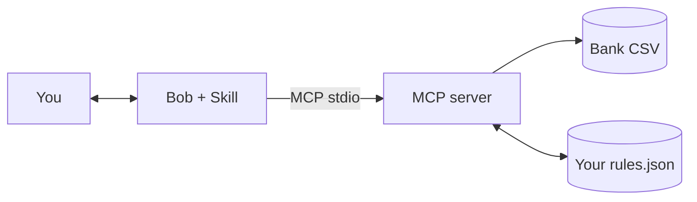

# Personal Expense Categorizer

A Bob **Skill + MCP server** that reads CSV bank exports and tags every transaction with a category.
It runs entirely on your machine: no network calls, no accounts, no API keys.

- Auto-detects bank CSV layouts (delimiter, header row, date order, debit/credit columns, sign convention)
- Tags each transaction with category, kind (expense / income / transfer) and merchant, and tells you which rule matched
- Summarizes spending by category and month; finds subscriptions and other recurring charges
- Learns: confirm a merchant once and it is categorized correctly from then on
- Exports a clean categorized CSV

Design details: [docs/ARCHITECTURE.md](docs/ARCHITECTURE.md)

## How it works



The **skill** ([.bob/skills/personal-expense-categorizer/SKILL.md](.bob/skills/personal-expense-categorizer/SKILL.md))
guides the conversation: categorize, ask you about unknown merchants in one batch, save your answers, report.
The **MCP server** does the deterministic work: parsing, matching, math, file access.

## Install

Requires Node.js 20 or newer.

```bash
git clone <your-repo-url> personal-expense-categorizer
cd personal-expense-categorizer
npm install
npm run build
npm test          # builds and runs 27 tests
```

### Register the MCP server in Bob

Add to your workspace or global `mcp.json` (also in [examples/mcp.json](examples/mcp.json)), using the
absolute path to this checkout:

```json
{
  "mcpServers": {
    "personal-expense-categorizer": {
      "command": "node",
      "args": ["/absolute/path/to/personal-expense-categorizer/build/src/index.js"]
    }
  }
}
```

For a workspace config opened on this repo, `"${workspaceFolder}/build/src/index.js"` also works.
Bob reconnects automatically when the file is saved.

### Install the skill

The skill lives at `.bob/skills/personal-expense-categorizer/`. It is picked up automatically when this
repo is your workspace. To use it in every workspace, copy the folder:

```bash
mkdir -p ~/.bob/skills
cp -R .bob/skills/personal-expense-categorizer ~/.bob/skills/
```

Start a new task afterwards so Bob loads it.

## Usage

Try it on the bundled fixtures. Ask Bob:

> Categorize `/absolute/path/to/test-data/sample-checking-us.csv` and show me a spending summary.

Expected shape of the result for that file:

| | |
|---|---|
| Period | 2025-01-02 to 2025-03-28 |
| Income | 9,600.00 |
| Expenses | 5,765.63 (transfers of 900.00 excluded) |
| Largest category | Housing, 4,350.00 (75.45%) |
| Uncategorized | 2 rows (`MYSTERY VENDOR LLC`, 54.00) |
| Recurring | Rent, PG&E, Shell, Planet Fitness, Netflix, Spotify |

Bob will then ask what category `MYSTERY VENDOR LLC` belongs to, save the rule, and the next run shows 0 uncategorized.

Other prompts:

- "Which of my subscriptions are recurring, and what do they cost per month?"
- "Export the categorized transactions next to the original file."
- "This bank writes dates day-first. Re-run it."

## MCP tools

| Tool | What it does |
|---|---|
| `categorize_transactions` | Parse and tag all rows. `only_uncategorized` lists what no rule matched |
| `summarize_spending` | Totals, by category with share, by month, uncategorized total |
| `find_recurring_charges` | Weekly, monthly and yearly repeats with next expected date |
| `list_categories` | Categories, kinds and rule counts; shows your rules file path |
| `add_category_rule` | Save `keyword -> category` (idempotent) |
| `export_categorized_csv` | Write `id,date,description,merchant,amount,category,kind,source` to a new `.csv` |

Every parsing tool accepts these options when auto-detection needs help:

| Option | Values |
|---|---|
| `date_format` | `auto` (default), `MDY`, `DMY` |
| `amount_convention` | `auto` (default), `negative_is_expense`, `positive_is_expense` |
| `column_map` | `{ date, description, amount, debit, credit }` exact header names |

## Supported CSV shapes

| Feature | Supported |
|---|---|
| Delimiters | comma, semicolon, tab |
| Amount columns | single signed `Amount`, or separate `Debit` / `Credit` |
| Date formats | `2025-01-31`, `01/31/2025`, `31/01/2025`, `31.01.2025`, `31 Jan 2025`, `Jan 31, 2025`, 2-digit years |
| Money formats | `$1,234.56`, `1.234,56`, `(19.99)`, `12.50-` |
| Quirks | BOM, CRLF, quoted fields with commas, lines of account info above the header |

Not supported yet: PDF, OFX/QFX, XLSX, live bank connections.

## Customizing categories

Defaults are in [config/default-categories.json](config/default-categories.json). Your own rules are saved to
`~/.personal-expense-categorizer/rules.json` (override with the `EXPENSE_RULES_PATH` environment variable) and
always take precedence:

```json
{
  "categories": { "Pets": "expense" },
  "rules": [
    { "category": "Pets", "keyword": "petco" },
    { "category": "Dining", "keyword": "blue bottle" }
  ]
}
```

Matching is case- and punctuation-insensitive, on whole words. The longest matching keyword wins.

## Privacy and safety

- Local only: the server contains no network code and sends nothing anywhere.
- The server reads only `.csv`, `.tsv` or `.txt` files up to 10 MB (checked again after resolving symlinks), and only when a tool call names them.
- Set `EXPENSE_ALLOWED_DIRS` (e.g. `/Users/you/Downloads`, multiple folders separated by `:`) to restrict all reads and writes to those folders. Recommended; add it under `env` in your `mcp.json`.
- Export never overwrites unless you say so, and even then only replaces files this server exported earlier. It also neutralizes spreadsheet formula injection.
- `rules.json` is validated on load and saved with owner-only permissions (600).
- `.gitignore` blocks bank-export formats, `.env.*` and `rules.json`, except the five synthetic `test-data/` files. **Do not commit real statements.**
- See [SECURITY.md](SECURITY.md) for the threat model and how to report a vulnerability.
- Your Bob client may send tool results to its model provider. Tool results include transaction descriptions
  and amounts, so use a provider you are comfortable with for financial data.

## Project layout

```text
.bob/skills/personal-expense-categorizer/SKILL.md   conversation workflow
src/                index.ts (tools) | service.ts | parser.ts | csv.ts | rules.ts | analysis.ts | types.ts
config/             default-categories.json
test-data/          5 synthetic CSV fixtures
tests/              unit + end-to-end MCP tests
docs/ARCHITECTURE.md
examples/mcp.json
```

## Development

```bash
npm run build     # tsc -> build/
npm test          # build + node:test (unit + stdio e2e)
npm start         # run the server on stdio (waits for an MCP client)
```

## Troubleshooting

| Symptom | Fix |
|---|---|
| Tools do not appear in Bob | Check the absolute path in `mcp.json` and that `npm run build` produced `build/src/index.js` |
| "Could not find a header row" | Pass `column_map` with the exact header names from the file |
| Dates look swapped | Pass `date_format: "DMY"` or `"MDY"` |
| Spending shows as income | Pass `amount_convention` (credit-card exports usually list purchases as positive) |
| "Refusing to read" | The file must end in `.csv`, `.tsv` or `.txt` |
| Skill not listed | Start a new task; confirm the folder name is exactly `personal-expense-categorizer` |

## License

MIT, see [LICENSE](LICENSE).
