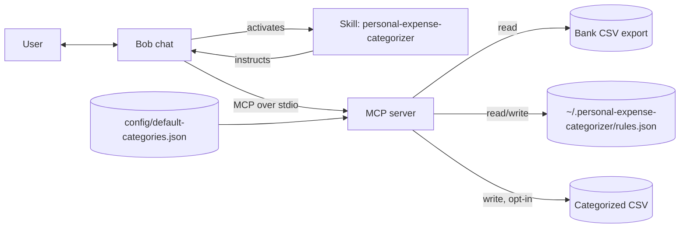
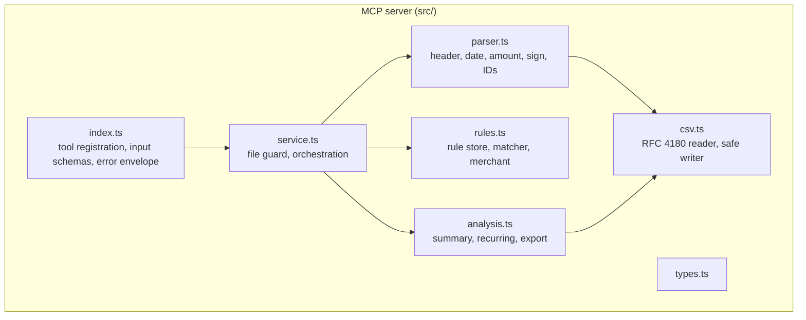
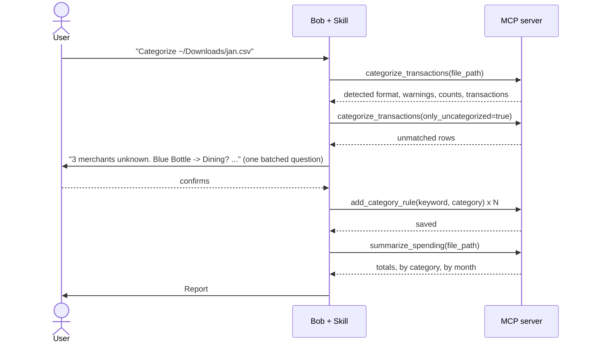

# Architecture and Component Design

Status: v0.1.0. Audience: contributors and reviewers.

## 1. Problem and goals

People export transactions from their bank as CSV and then spend hours tagging them in a spreadsheet.
Every bank uses a different layout, so generic tools break.

**Goals**

| # | Goal | How it is met |
|---|------|---------------|
| G1 | Handle the formats real banks produce | Header and delimiter auto-detection, debit/credit columns, date-order inference, preamble skipping |
| G2 | Deterministic, auditable categories | Keyword rules; every result carries the rule that matched |
| G3 | Private by default | Local stdio process, no network code, no telemetry, files read only on request |
| G4 | Improves with use | User corrections saved as rules that outrank the defaults |
| G5 | Natural conversation | A Bob skill orchestrates review and reporting on top of MCP tools |

**Non-goals (v0.1):** live bank connections (Plaid and similar), PDF/OFX/QFX import, multi-currency
conversion, budgets and forecasting, ML classification, a GUI.

## 2. Why a Skill and an MCP server

| Concern | Skill (`SKILL.md`) | MCP server |
|---|---|---|
| Role | Procedure: what to ask, in what order, how to present | Capability: parse, match, aggregate, write files |
| Determinism | Model-driven, flexible | Code-driven, testable |
| Owns | Conversation, user confirmation, explanations | Numbers, file access, rule storage |

Arithmetic and parsing must not depend on a language model, so they live in the server. Judgment calls
(which category for an unknown merchant, which date order does this bank use) live in the skill, which asks the
user and writes the answer back through a tool.

## 3. System context



Trust boundary: everything right of "MCP server" is on the user's machine. No arrow leaves the machine.

## 4. Component design



| Component | Responsibility | Key decisions |
|---|---|---|
| `index.ts` | Registers 6 tools with zod schemas and annotations; converts exceptions to `isError` results | Thin: no business logic. Logs to stderr only, because stdout is the protocol channel |
| `service.ts` | Reads the file (extension allow-list `.csv/.tsv/.txt`, 10 MB cap), runs parse, categorize, then the requested report | Single place for file-system safety checks: symlink-resolved extension check, optional `EXPENSE_ALLOWED_DIRS` sandbox, 10 MB cap. Export uses the `wx` flag for new files and only replaces a file that starts with its own export header |
| `parser.ts` | Finds the header row in the first 20 rows, maps columns by alias, resolves dates, amounts and sign convention, assigns stable IDs | Pure function of text. Ambiguity produces a warning, not a guess hidden from the user |
| `csv.ts` | Dependency-free CSV state machine (quotes, escaped quotes, CRLF, BOM, `,` `;` tab); `csvField` escapes output | Output fields starting with `= + - @` are prefixed with `'` to block spreadsheet formula injection |
| `rules.ts` | Loads default and user rules, validates `rules.json`, normalizes text, matches, derives the merchant name, persists user rules (mode 600) | Whole-phrase matching on normalized text; longest keyword wins; user beats default on ties |
| `analysis.ts` | Spending summary, recurring-charge detection, categorized CSV output | Transfers excluded from income and expense so paying a credit card is not counted twice |

### 4.1 Data model

```text
RawTransaction   id, row, date (ISO), description, amount (signed: negative = money out)
Transaction      RawTransaction + merchant, category, kind (expense|income|transfer),
                 matched_rule, source (user|default|none)
Rule             category, keyword (normalized), source
```

The parser normalizes every bank to one convention (negative = money out) so nothing downstream cares which
bank the file came from.

## 5. Key flows

### 5.1 Categorize and learn



### 5.2 Parsing pipeline


### 5.3 Matching algorithm

1. Normalize the description: lowercase, every run of non-alphanumerics becomes one space.
2. A rule matches if its normalized keyword appears as a whole phrase (space-delimited). `bp` does not match `abps`.
3. Among matches pick the longest keyword (`uber eats` beats `uber`). On equal length a user rule beats a default.
4. No match: category `Uncategorized`, kind inferred from the sign.
5. Merchant is derived by stripping processor prefixes (`POS`, `SQ *`, `PAYPAL *`), trailing store numbers
   and state codes, and keeping the first three words. It is used for grouping and recurring detection.

### 5.4 Recurring detection

Group expenses by merchant. A group qualifies with at least 3 charges, at least 3 amounts within 15% of the
median, a median gap of 7 days (6 to 8), a month (27 to 34) or a year (360 to 370), and at least 70% of
gaps within 4 days of the median. Output includes typical amount and next expected date.

## 6. MCP tool contract

| Tool | Type | Inputs (beyond the shared parse options) | Output |
|---|---|---|---|
| `categorize_transactions` | read-only | `only_uncategorized`, `limit` (max 1000) | Detected format, warnings, counts per category, transactions, `truncated` |
| `summarize_spending` | read-only | | Period, totals, by category (with share), by month, uncategorized total |
| `find_recurring_charges` | read-only | | Recurring groups, estimated monthly total |
| `list_categories` | read-only | | Categories, kinds, rule counts, rules file path |
| `add_category_rule` | write (local rules file) | `keyword` (max 100 chars), `category` (max 60), `kind?` | Path, `added` (idempotent) |
| `export_categorized_csv` | write, `destructiveHint: true` | `output_path` (.csv), `overwrite?` | Resolved path, row count |

Shared parse options: `file_path`, `date_format` (auto, MDY, DMY), `amount_convention` (auto,
negative_is_expense, positive_is_expense), `column_map`.

Errors are returned as `isError: true` with a message the model can act on (for example "pass column_map with
the exact header names"), not as protocol errors.

## 7. Storage

| Data | Location | Notes |
|---|---|---|
| Default rules | `config/default-categories.json` | Versioned in the repo; 14 categories |
| User rules | `~/.personal-expense-categorizer/rules.json` (override with `EXPENSE_RULES_PATH`) | Created on first `add_category_rule` with mode 600 (directory 700); plain JSON the user can edit; shape and lengths validated on load |
| Transactions | Not stored | Re-read from the source CSV on each call; IDs are stable hashes so results can be correlated |

## 8. Security and privacy

| Threat | Mitigation |
|---|---|
| Data exfiltration | No network code and no runtime dependency beyond the MCP SDK and zod |
| Arbitrary file read via tool argument | Extension allow-list checked before and after resolving symlinks, regular-file check, 10 MB cap, optional `EXPENSE_ALLOWED_DIRS` sandbox. The e2e test confirms `/etc/passwd` is refused |
| Arbitrary file overwrite via export | Must end in `.csv`, resolved real path must differ from input and sit inside `EXPENSE_ALLOWED_DIRS` when set; existing files are refused unless `overwrite=true` **and** the file starts with this tool's export header; tool is annotated `destructiveHint: true` |
| Malformed or oversized rules | `rules.json` shape is validated; keyword, category, path and header lengths are capped; file is mode 600 |
| Spreadsheet formula injection in exported CSV | Text fields starting with `= + - @` or control whitespace are prefixed with `'` |
| Prompt injection through merchant text | Skill instructs the model to treat descriptions as data; tools never execute or fetch their content |
| Committing real statements | `.gitignore` excludes `*.csv/.tsv/.txt/.xlsx/.ofx/.qfx/.pdf`, `.env.*` and `rules.json`, with exceptions only for the five named fixtures; all fixtures are synthetic |
| Credentials | None required |

Residual risk: unless `EXPENSE_ALLOWED_DIRS` is set, any file path the user's MCP client can name with an allowed
extension is readable by the server. The server runs with the user's own privileges. See [SECURITY.md](../SECURITY.md).

## 9. Error handling and observability

- Row-level problems (bad date, bad amount, empty description) skip the row and add a warning; the first 10 are returned.
- File-level problems (no header, too large, wrong type) fail the call with an actionable message.
- Logging goes to stderr only. No transaction content is logged.

## 10. Testing strategy

| Layer | File | Covers |
|---|---|---|
| Unit | `tests/categorizer.test.ts` | CSV tokenizer, amount formats, 5 fixtures, date ambiguity, matching precedence, summary math, recurring, export escaping |
| Security | `tests/security.test.ts` | Overwrite protection for foreign files, symlink handling, `EXPENSE_ALLOWED_DIRS`, rules validation, length caps, file mode, `.gitignore` rules |
| End to end | `tests/mcp-e2e.test.ts` | Spawns the built server, real JSON-RPC handshake, `tools/list`, destructive annotation, learning loop, export overwrite protection, path refusal |

Fixtures in `test-data/` are synthetic and each targets a behavior:

| File | Purpose |
|---|---|
| `sample-checking-us.csv` | 43 rows over 3 months, extra columns, subscriptions, transfers, a refund, two unknown merchants |
| `sample-bank-eu-debit-credit.csv` | Semicolon delimiter, separate Debit/Credit, DMY dates, `1.234,56` |
| `sample-credit-card-positive.csv` | Purchases positive, payment negative |
| `sample-edge-cases.csv` | BOM, CRLF, preamble lines, quoted comma, formula text, three bad rows, `($19.99)` |
| `sample-ambiguous-dates.csv` | All day/month values at most 12 |

## 11. Decisions and trade-offs

| Decision | Alternative | Why |
|---|---|---|
| Keyword rules | LLM or ML classifier | Reproducible, explainable, free, offline. The skill uses the LLM only for the long tail, with user confirmation |
| Stateless transactions | Local database | Source CSV is the truth; avoids sync and stale data; simple to reason about |
| Own CSV parser | `csv-parse` | About 70 lines, no dependency, handles the cases above |
| Normalize sign to negative = out | Keep bank's sign | One convention downstream; the detected convention is reported back |
| stdio transport | HTTP | Local data, no ports, no auth |
| `node:test` | Jest/Vitest | No test dependencies |

## 12. Known limitations

- English-centric default keywords; other languages need user rules.
- Multi-currency files are summed as if one currency.
- Split transactions and per-transaction manual overrides are not supported; rules apply by keyword.
- Duplicate detection across overlapping exports is not implemented, but stable IDs make it straightforward to add.
- Two-digit-year dates assume 20xx.
- Amount sign auto-detect uses a 75% positive threshold; unusual files may need `amount_convention`.

## 13. Roadmap

1. v0.2: per-transaction overrides by ID, merge of overlapping exports, budget targets per category.
2. v0.3: OFX/QFX import, multi-currency with user-supplied rates.
3. v0.4: MCP resources exposing the rule set, and an MCP prompt for the monthly review.
